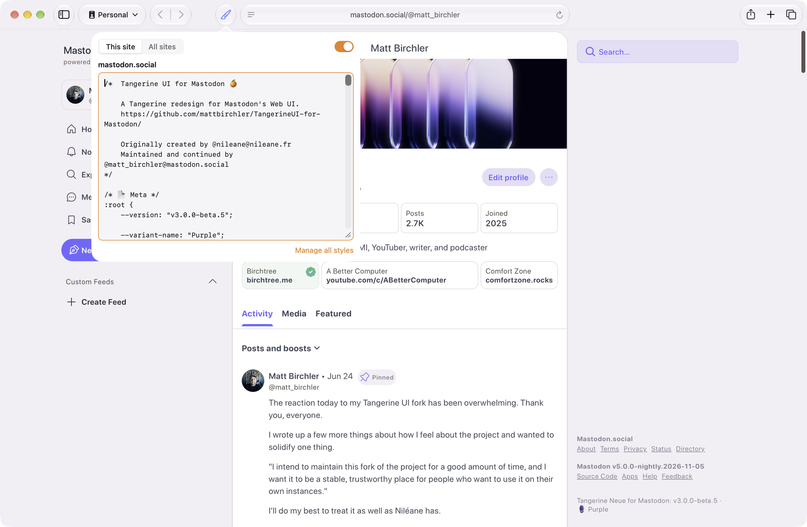
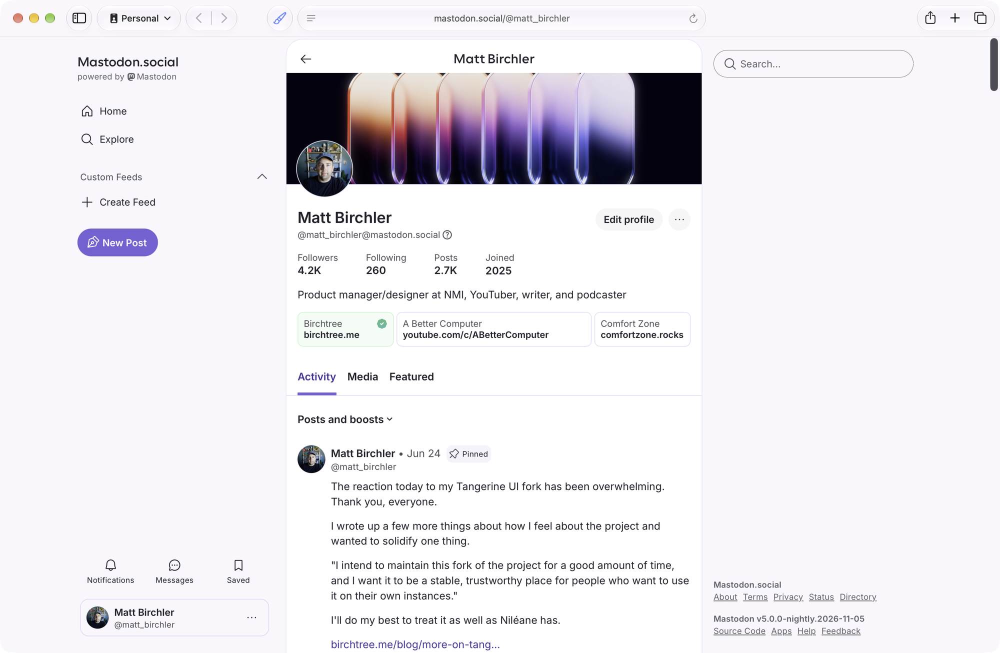
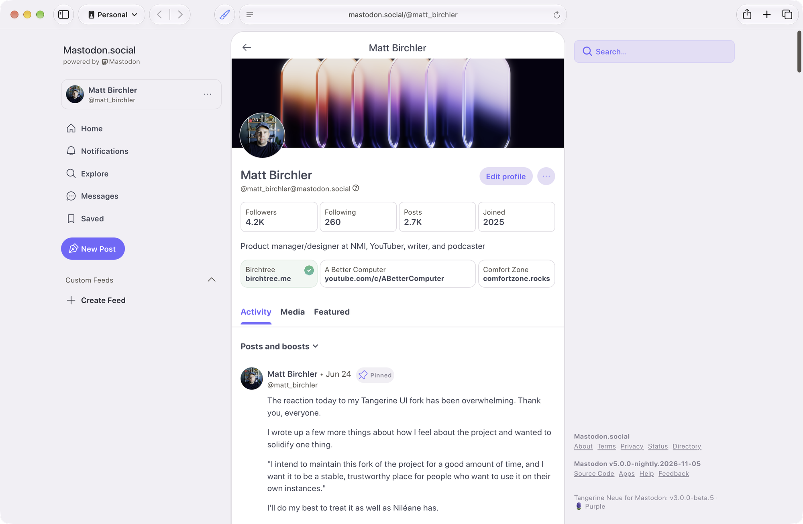
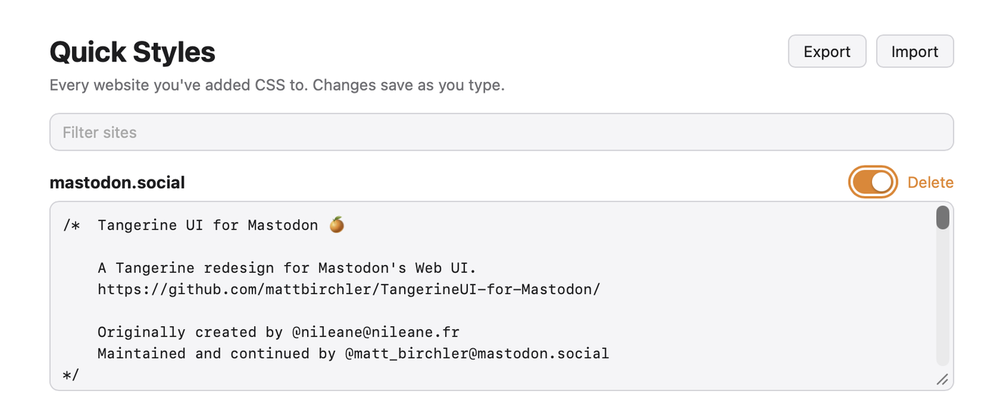

<p align="center">
  
</p>

<h1 align="center">Quick Styles</h1>

<p align="center">
  Restyle any website in Safari with your own CSS.<br>
  Free and open source, for the Mac.
</p>

<p align="center">
  <a href="https://github.com/mattbirchler/quick-styles/releases/latest"><strong>Download the latest release</strong></a>
</p>



Click the paintbrush in Safari's toolbar, type some CSS, and the page changes as you type. Quick Styles remembers it, so the next time you visit that site your styles are already there.

Use it to fix a font that's hard to read, hide a distracting sidebar, or give a site you use every day a complete makeover.

## See it in action

Here's mastodon.social without and with [Tangerine UI](https://github.com/mattbirchler/TangerineUI-for-Mastodon), a full redesign of Mastodon's web app that's just a CSS file:

| Before | After |
| --- | --- |
|  |  |

It works on sites with strict security settings, like Mastodon, that block the usual ways extensions add CSS.

## Features

- **Styles for each site.** CSS you add applies to the whole site you're on. `www.example.com` and `example.com` count as the same site.
- **Styles for every site.** The **All sites** tab holds CSS that applies everywhere, for things like a favorite font or a darker scrollbar.
- **Live preview.** Changes appear as you type. There's no save button.
- **On/off switch.** Turn a site's styles off to compare with the original, then turn them back on.
- **One place to manage it all.** **Manage all styles** lists every site you've styled, with search, editing, and delete. Export everything to a JSON file to back it up or move it to another Mac.
- **Private by design.** No accounts, no analytics, no network requests. Your CSS is stored by Safari on your Mac and never leaves it.



## Install

1. Download `QuickStyles.dmg` from the [latest release](https://github.com/mattbirchler/quick-styles/releases/latest) and drag Quick Styles into Applications.
2. Open Quick Styles and click **Open Safari Extension Settings**.
3. Turn on Quick Styles. When Safari asks, allow it on all websites so your styles load on their own.

Quick Styles updates itself with [Sparkle](https://sparkle-project.org). You can also choose **Quick Styles > Check for Updates** in the app.

Requires macOS 14 Sonoma or later.

## Tips

- Your styles are added after the site's own stylesheets, so a rule with the same specificity wins. If a site's rule still wins, use a more specific selector or add `!important`.
- Safari's Web Inspector (**Develop > Show Web Inspector**) is the easiest way to find the selectors you want to change.
- `@import` isn't supported. Paste the CSS itself instead.

## Building from source

You need Xcode and [XcodeGen](https://github.com/yonaskolb/XcodeGen) (`brew install xcodegen`). The Xcode project is generated from `project.yml`.

```bash
make build     # Debug build
make run       # build and open the Debug app
make install   # Release build into /Applications
```

Each copy of the app registers its own Safari extension, so a Debug build and an installed copy show up as two entries in Safari's settings. `make install` removes and unregisters the copies in `build/`, leaving `/Applications` as the only one. `make unregister-builds` does just the cleanup.

To run a local build in Safari, turn on **Safari > Settings > Advanced > Show features for web developers**, then **Develop > Developer Settings > Allow unsigned extensions**.

Releases are covered in [RELEASING.md](RELEASING.md).

## How it works

The extension is a plain Manifest V3 web extension in `Extension/Resources`:

- `content.js` runs on every page. It reads the styles for that site from `browser.storage.local` and applies them with a constructed stylesheet (`document.adoptedStyleSheets`). Sites with a strict Content Security Policy block `<style>` tags added by extensions, but they don't block constructed stylesheets. The script also listens for storage changes, which is how the live preview works.
- `popup.html/js` is the toolbar editor.
- `options.html/js` is the **Manage all styles** page.

The Mac app in `App/` exists because Safari extensions ship inside an app. It shows whether the extension is on and handles updates.

## License

MIT. See [LICENSE](LICENSE).
